# Digital-Logic-Basics
Synthesizable digital logic components designed in Vivado.

---

## 1. Basic Logic Gates

### Simulation Results

The following waveform verifies the truth table functionality for all logic gates:

**Waveform Legend:**
* **a, b**: Inputs
* **y1**: NAND (Returns 0 only when both inputs are 1)
* **y2**: AND (Returns 1 only when both inputs are 1)
* **y3**: OR (Returns 1 if any input is 1)
* **y4**: NOT a (Inverts input a)
* **y5**: NOT b (Inverts input b)
* **y6**: XOR (Returns 1 if inputs are different)
* **y7**: XNOR (Returns 1 if inputs are the same)

---

### Synthesis (RTL Schematic)
The following circuit diagram shows the synthesized hardware implementation:

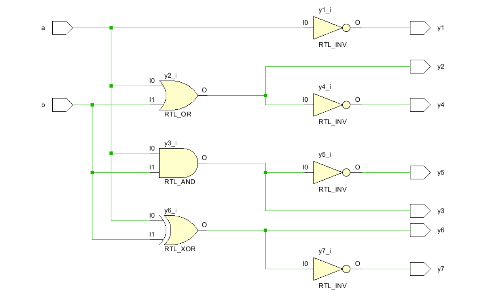

---

## 2. 2:1 Multiplexer
This module selects between two 4-bit input buses based on a single select line.

### Simulation Results
The following waveform verifies that the output correctly switches between input `i0` and `i1` based on the select line `s0`.

**Waveform Legend:**
* **s0**: Select Line (0 selects 'i0', 1 selects 'i1')
* **i0**: Input Bus 0 (Value: 0)
* **i1**: Input Bus 1 (Value: 1)
* **y**: Output Bus

---

### Synthesis (RTL Schematic)
The following circuit diagram shows the synthesized hardware implementation, confirming 4-bit data paths and multiplexing logic:

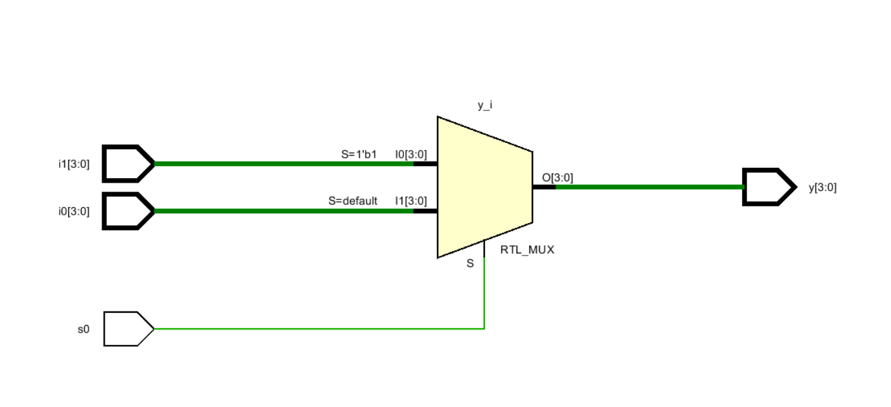

---

## 3. 4:1 Multiplexer
This module selects between four 3-bit input buses based on a 2-bit select line.

### Simulation Results
The following waveform verifies the selection logic across all four channels:

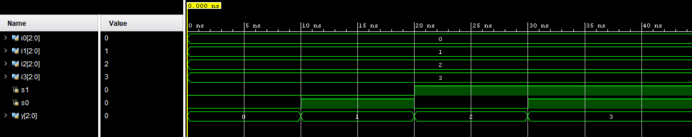

**Waveform Legend:**
* **s1, s0**: Select Lines (00->i0, 01->i1, 10->i2, 11->i3)
* **i0 - i3**: 3-bit Input Data Buses
* **y**: Output Bus

---

### Synthesis (RTL Schematic)
The following circuit diagram shows the synthesized hardware implementation, confirming the 4:1 multiplexing logic and 3-bit data paths:

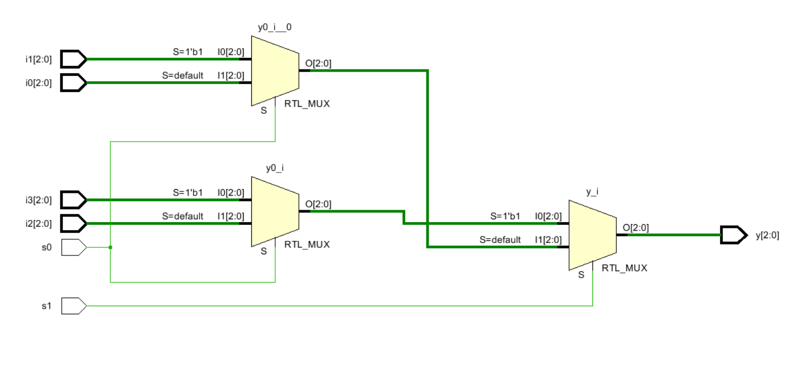

---

## 4. 1:4 Demultiplexer
This module routes a single 3-bit input bus to one of four output buses based on a 2-bit select line.

### Simulation Results
The following waveform demonstrates the input data (Value: 5) being routed to outputs y0 through y3 sequentially:

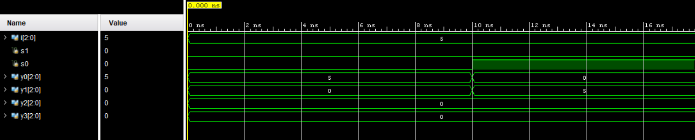

**Waveform Legend:**
* **i**: Input Data Bus (Fixed at value 5)
* **s1, s0**: Select Lines
* **y0 - y3**: Output Buses

---

### Synthesis (RTL Schematic)
The following circuit diagram shows the synthesized hardware implementation, confirming the 1-to-4 data routing logic:

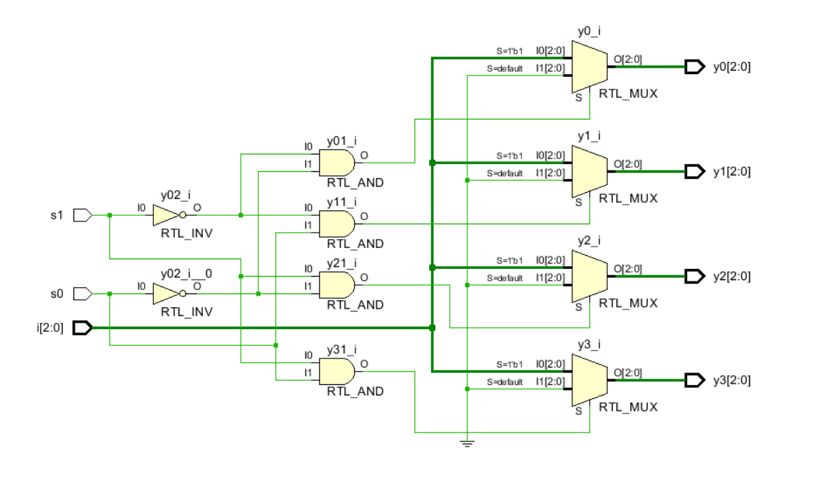

---

## 5. D Flip-Flop (Async Reset, Sync Enable)
This module implements a standard D Flip-Flop with an active-high asynchronous reset and a synchronous enable signal.

### Simulation Results
The following waveform demonstrates synchronous loading (when en=1), state holding (when en=0), and asynchronous reset priority:

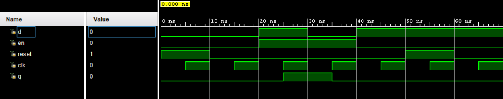

**Waveform Legend:**
* **clk**: Clock Signal (100 MHz)
* **reset**: Asynchronous Reset (Active High)
* **en**: Enable Signal
* **d**: Data Input
* **q**: Data Output

---

### Synthesis (RTL Schematic)
The following circuit diagram confirms the synthesis of a D-Flip Flop with dedicated Clock Enable (CE) and Asynchronous Clear (CLR) pins:

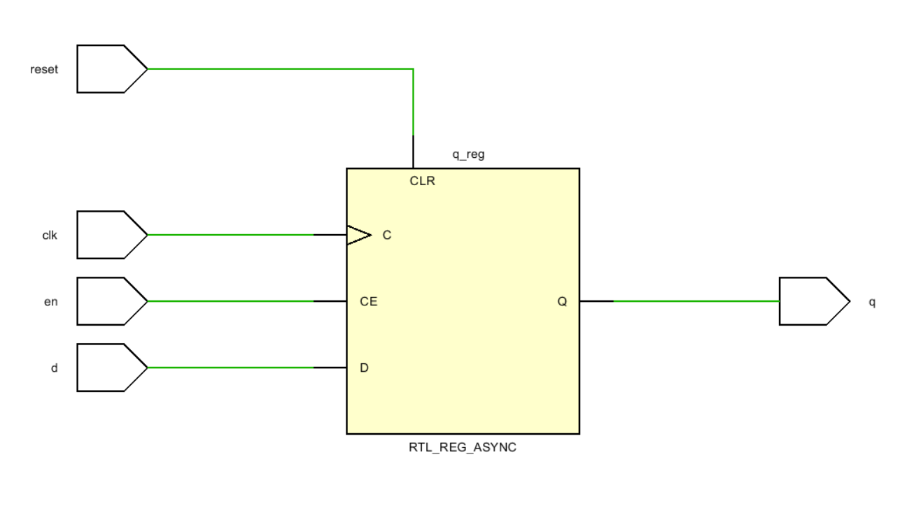

---

## 6. D-Latch (Async Reset, Level-Sensitive Enable)

This module implements a transparent D-Latch with an active-high asynchronous reset and a level-sensitive enable signal.

### Simulation Results

The following waveform validates the circuit's operation. It demonstrates the transparency phase (when en=1), state retention (when en=0), and the immediate priority of the asynchronous reset:

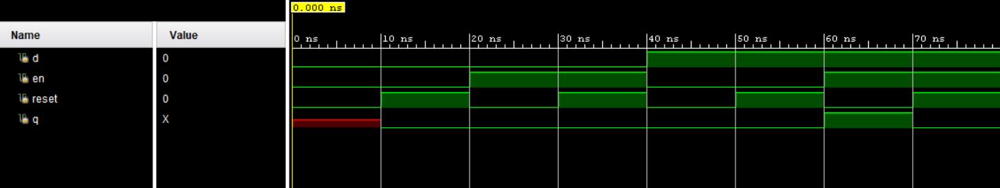

**Waveform Legend:**

* **reset**: Asynchronous Reset (Active High)
* **en**: Enable Signal (Level Sensitive)
* **d**: Data Input
* **q**: Data Output

---

### Synthesis (RTL Schematic)
The following circuit diagram shows the synthesized hardware implementation, confirming the basic latch structure with the asynchronous reset path:

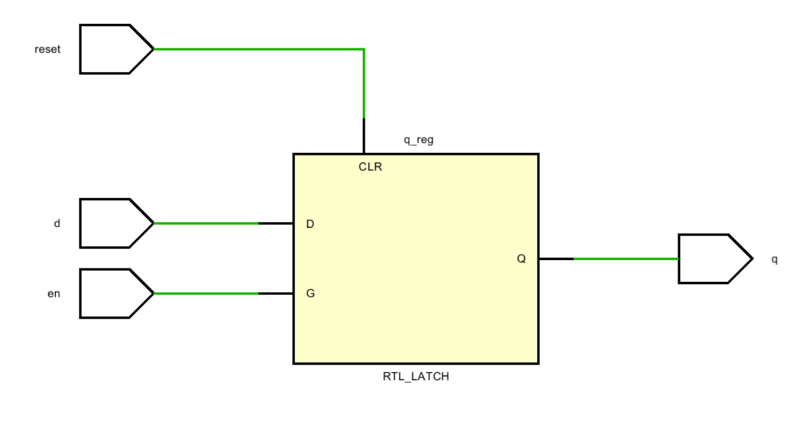

---

## 7. 8:3 One-Hot Encoder
This module encodes an 8-bit one-hot input vector into a 3-bit binary output. It utilizes a `case` statement with a default clause to prevent unintentional latch inference during synthesis.

### Simulation Results
The following waveform confirms the correct binary encoding for each active-high bit position in the input vector:

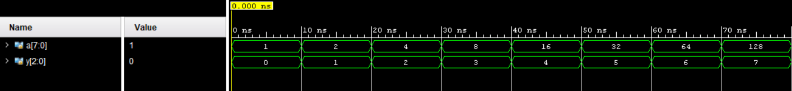

**Waveform Legend:**
* **a**: 8-bit One-Hot Input
* **y**: 3-bit Binary Output

---

### Synthesis (RTL Schematic)
The following circuit diagram shows the synthesized hardware implementation. The tool inferred a Read-Only Memory (RTL_ROM) structure to implement the look-up table logic, confirming a purely combinational design:

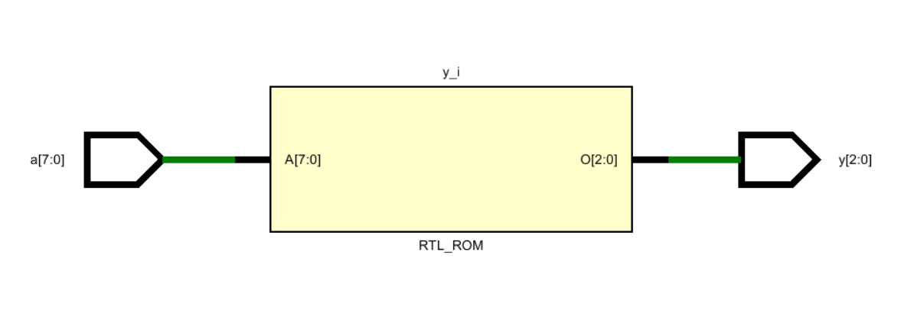

---

## 8. 8:3 Priority Encoder
This module implements a priority encoder using the `casex` statement. It converts an 8-bit input into a 3-bit binary output, assigning priority to the highest-order active bit (Bit 7 has highest priority).

### Simulation Results
The following waveform verifies the priority logic. Note the final test case where inputs `00000011` result in output `1`, confirming that Bit 1 takes priority over Bit 0:

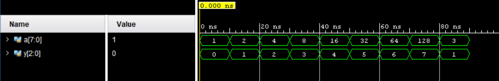

**Waveform Legend:**
* **a**: 8-bit Input Vector
* **y**: 3-bit Output (Index of highest active bit)

---

### Synthesis (RTL Schematic)
The following circuit diagram shows the synthesized hardware implementation. The tool inferred an `RTL_ROM` structure to efficiently map the priority logic truth table, confirming a combinational design without accidental latches:

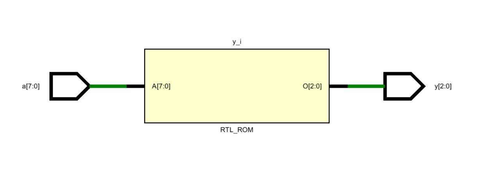

---

## 9. 4-Bit Synchronous Counter
This module implements a synchronous decade (Mod-10) counter. It is designed to count from 0 to 9 and wrap around, with directional control and asynchronous reset capabilities.

### Simulation Results
The following waveform validates the correct timing and logic of the synchronous counter. It demonstrates the asynchronous reset functionality (0-20ns), the standard up-counting sequence wrapping cleanly from 9 to 0, and the immediate switch to down-counting logic upon the `updown` signal transition at the 200ns mark:

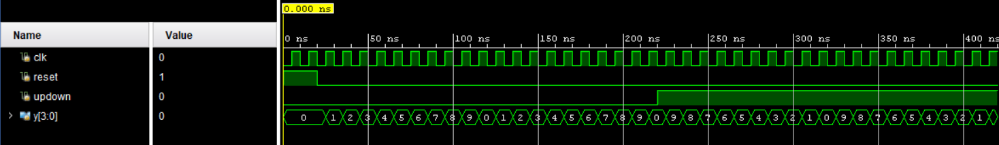

**Waveform Legend:**
* **clk**: System Clock
* **reset**: Asynchronous Reset (Active High)
* **updown**: Direction Control (0 = Up, 1 = Down)
* **y**: 4-bit Output Count 

---

### Synthesis (RTL Schematic)
The following circuit diagram confirms the design architecture, utilizing separate `RTL_ADD` and `RTL_SUB` units for bidirectional counting. It features `RTL_MUX` logic to handle the Mod-10 wrap-around conditions and feeds into a 4-bit asynchronous register bank:

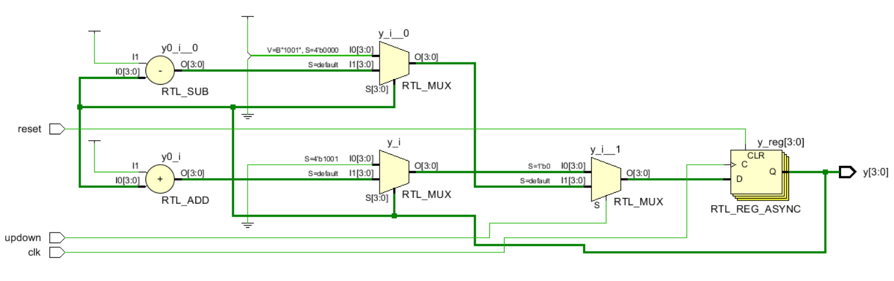 

---

### 10. Mealy 101 Sequence Detector
This module implements a Mealy Finite State Machine (FSM) to detect the pattern '101' in a serial bit stream. As a Mealy machine, the output depends on both the current state and the current input, allowing for immediate detection.

### Simulation Results
The following waveform validates the FSM logic. It demonstrates that the output `y` goes high immediately when the input `x` completes the '101' sequence (Logic 1 at State S2), verifying the non-overlapping detection logic:

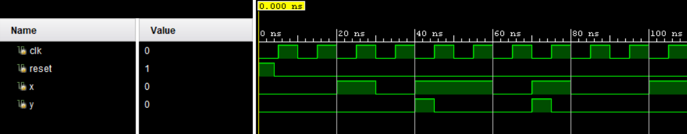

**Waveform Legend:**
* **clk**: System Clock
* **reset**: Asynchronous Reset (Active High)
* **x**: Serial Input Stream
* **y**: Output Flag (High when '101' is detected)

---

### Synthesis (RTL Schematic)
The following circuit diagram confirms the synthesized hardware implementation. The tool correctly extracted the FSM logic, implementing the three states (s0, s1, s2) using state registers and generating the Mealy output logic directly from the current state and input:

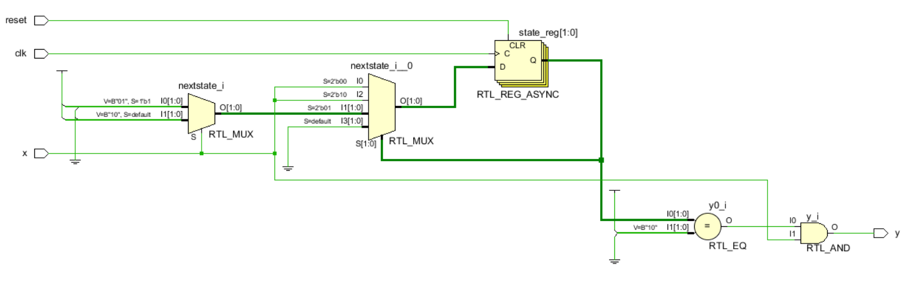

---
## 11. Moore 101 Sequence Detector
This module implements a Moore Finite State Machine (FSM) to detect the non-overlapping '101' pattern. In a Moore machine, the output depends **only** on the current state, not the immediate input.

### Simulation Results
The waveform below verifies the design. Notice that unlike the Mealy machine, the output `y` goes high **one clock cycle after** the sequence '101' is detected (when the state actually transitions to s3):

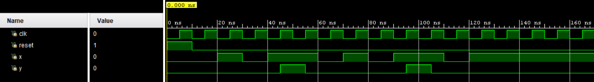

**Waveform Legend:**
* **clk**: System Clock
* **reset**: Asynchronous Reset
* **x**: Serial Input Stream
* **y**: Output Flag (High at state s3)

---

### Synthesis (RTL Schematic)
The following circuit diagram confirms the synthesized hardware implementation. The tool correctly extracted the Moore FSM logic. Note that the output `y` is generated by an equality check (`RTL_EQ`) connected **only** to the state register, verifying that the output is decoupled from the immediate input `x`:

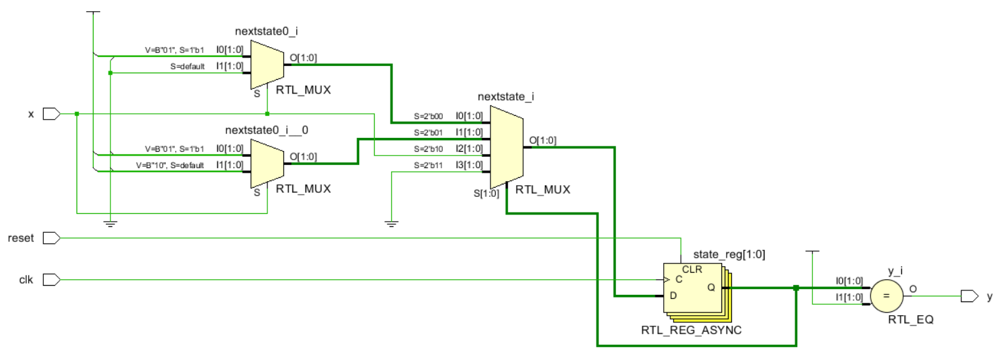

---

## 12. Read-Only Memory (ROM)
This module implements a 4x3-bit Read-Only Memory (ROM) using a synchronous Look-Up Table (LUT) approach. It demonstrates how constant data can be stored efficiently in the FPGA logic fabric (Distributed RAM) without using dedicated Block RAM resources.

### Simulation Results
The following waveform verifies the synchronous read operation over the full address range. It demonstrates the correct mapping of addresses to data (0→2, 1→4, 2→3, 3→6) and confirms that the output holds its previous state when the enable signal is de-asserted:

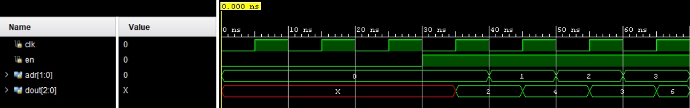

**Waveform Legend:**
* **clk**: System Clock
* **en**: Enable Signal (Active High)
* **adr**: 2-bit Address Input
* **dout**: 3-bit Data Output (Values: 2, 4, 3, 6)

---

### Synthesis (RTL Schematic)
The following circuit diagram shows the synthesized hardware implementation. The tool inferred a multiplexer-based structure (`RTL_MUX`) to map the address inputs to the hardcoded data constants, which are then registered by `RTL_REG` to ensure synchronous output:

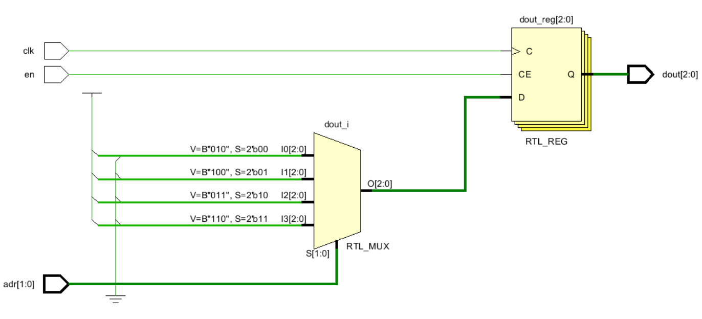

