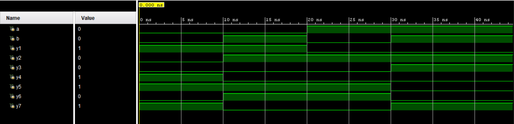

# Digital-Logic-Basics
Synthesizable digital logic components designed in Vivado.

---

## 1. Basic Logic Gates

## Simulation Results

The following waveform verifies the truth table functionality for all logic gates:

**Waveform Legend:**
* **a, b**: Inputs
* **y1**: NAND (Returns 0 only when both inputs are 1)
* **y2**: AND (Returns 1 only when both inputs are 1)
* **y3**: OR (Returns 1 if any input is 1)
* **y4**: NOT a (Inverts input a)
* **y5**: NOT b (Inverts input b)
* **y6**: XOR (Returns 1 if inputs are different)
* **y7**: XNOR (Returns 1 if inputs are the same)

---

## Synthesis (RTL Schematic)
The following circuit diagram shows the synthesized hardware implementation:

